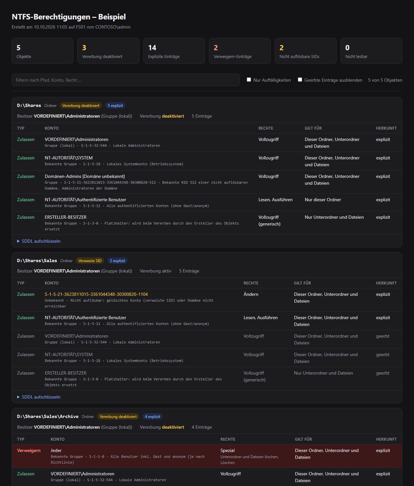

# NtfsPermissions – NTFS permission viewer & SDDL decoder for PowerShell

[](https://github.com/feiglein74/AD_NTFS-Permissions/actions/workflows/ci.yml)
[](https://github.com/feiglein74/AD_NTFS-Permissions/releases)


A PowerShell module that makes **NTFS permissions (ACLs) readable**. It reads folders you have no access to (via `SeBackupPrivilege`) and decodes **SDDL** strings token by token. It resolves **SIDs** for users, groups and well-known accounts, and flags orphaned SIDs, deny entries and disabled inheritance. It also writes a self-contained **HTML audit report**. Think `Get-Acl` / `icacls`, but human-friendly.


## Quickstart

```powershell
git clone https://github.com/feiglein74/AD_NTFS-Permissions.git
Import-Module .\AD_NTFS-Permissions\NtfsPermissions\NtfsPermissions.psd1

Show-NtfsPermission D:\Shares -Sddl                                   # colored console view + SDDL breakdown
Get-NtfsPermission D:\Shares -Recurse -ExplicitOnly                   # objects for filtering / CSV export
Export-NtfsPermissionReport D:\Shares -Recurse -OutFile .\report.html -Open
```

Run PowerShell **as Administrator** to read folders your account has no access to. Works on Windows PowerShell 5.1 and PowerShell 7.

## Features

- **Read any folder's ACL**: enables `SeBackupPrivilege` for the current process only, no system changes
- **SDDL decoder**: `(A;OICI;0x1301bf;;;BU)` → *Allow · Builtin\Users · Modify · This folder, subfolders and files*, works offline on any SDDL string
- **SID resolution**: users, groups, computers and well-known SIDs (e.g. `S-1-5-11`, `S-1-5-32-544`, `NT SERVICE\…`, integrity levels). Domain RIDs like `-512` (Domain Admins) are still named when the domain is unreachable. Orphaned SIDs from deleted accounts are flagged.
- **Explorer-style rights** ("Full control", "Modify", "Read & execute", "Special"), generic rights mapped, *Applies to* column
- **Audit findings**: disabled inheritance, explicit entries, deny entries, non-canonical ACE order, NULL DACL
- **Output**: colored console, pipeline objects (CSV/Excel), standalone HTML report with search and filters



> Detailed documentation is in German. Output labels are German.

---

# Dokumentation (Deutsch)

PowerShell-Modul, um NTFS-Berechtigungen **lesbar** zu machen:

- liest Berechtigungen auch von Ordnern, auf die man selbst keinen Zugriff hat (über `SeBackupPrivilege`, als Administrator)
- fasst Rechte so zusammen wie der Explorer („Ändern“, „Lesen, Ausführen“, „Spezial“ …) und übersetzt generische Rechte (`GA`, `GR` …)
- übersetzt die Vererbungsflags in die Explorer-Spalte „Gilt für“
- **schlüsselt SDDL Token für Token auf**, z. B. `(A;OICI;0x1200a9;;;BU)`
- **löst SIDs auf**, mit Kontotyp (Benutzer, Gruppe, lokale Gruppe, bekannte Gruppe, Computer, Dienst …) und Erläuterung für bekannte SIDs
- markiert Auffälligkeiten: deaktivierte Vererbung, Verweigern-Einträge, verwaiste SIDs, nicht-kanonische Reihenfolge, NULL-DACL
- farbige Konsolenansicht, eigenständiger HTML-Bericht, CSV-Export über die Pipeline
- läuft unter Windows PowerShell 5.1 und PowerShell 7

## Installation

```powershell
# einmalig für die Sitzung
Import-Module .\NtfsPermissions\NtfsPermissions.psd1

# dauerhaft: Ordner NtfsPermissions in einen Pfad aus $env:PSModulePath kopieren, z. B.
Copy-Item .\NtfsPermissions "$HOME\Documents\PowerShell\Modules\" -Recurse
```

Für Ordner ohne eigenen Zugriff PowerShell **als Administrator** starten. Ohne Adminrechte funktioniert alles, was man selbst lesen darf. Das Modul gibt dann einmal eine Warnung aus.

## Befehle

| Befehl | Zweck |
|---|---|
| `Show-NtfsPermission` | farbige Konsolenansicht, optional mit `-Sddl`-Aufschlüsselung |
| `Get-NtfsPermission` | liefert Objekte zum Weiterverarbeiten (Filtern, CSV …) |
| `ConvertFrom-NtfsSddl` | schlüsselt einen beliebigen SDDL-String auf, ohne Dateisystemzugriff |
| `Export-NtfsPermissionReport` | HTML-Bericht mit Filter, Suche und Hell-/Dunkelmodus |

Alle Befehle haben eine Hilfe: `Get-Help Show-NtfsPermission -Full`.

## Beispiele

```powershell
# Ein Ordner, mit SDDL-Aufschlüsselung
Show-NtfsPermission D:\Daten\Projekte -Sddl

# Nur Abweichungen in den ersten 3 Ebenen (Vererbung aus, explizite Einträge, Fehler)
Show-NtfsPermission D:\Daten -Recurse -Depth 3 -ExplicitOnly

# Schmale Konsole: Zellen auf 30 Zeichen kürzen (gekürzte Zellen zeigen "… [+N Zeichen]")
Show-NtfsPermission D:\Daten -Truncate 30

# HTML-Bericht einer Freigabe
Export-NtfsPermissionReport \\fs01\abteilungen -Recurse -ExplicitOnly -OutFile .\abteilungen.html -Open

# Flache Liste aller Einträge als CSV (für Excel: Semikolon)
(Get-NtfsPermission D:\Daten -Recurse).Aces |
    Export-Csv .\rechte.csv -NoTypeInformation -Delimiter ';' -Encoding UTF8

# Wo hat ein bestimmtes Konto explizite Rechte?
(Get-NtfsPermission D:\Daten -Recurse -ExplicitOnly).Aces |
    Where-Object { -not $_.Inherited -and $_.Principal -like '*\GG_Vertrieb*' } |
    Select-Object Path, Rights, AppliesTo

# Wo sind einzelne Benutzer statt Gruppen berechtigt?
(Get-NtfsPermission D:\Daten -Recurse -ExplicitOnly).Aces |
    Where-Object { -not $_.Inherited -and $_.AccountType -eq 'Benutzer' } |
    Select-Object Path, Principal, Rights

# Verwaiste SIDs finden
(Get-NtfsPermission D:\Daten -Recurse -ExplicitOnly).Aces |
    Where-Object { -not $_.Resolved } | Select-Object Path, Sid -Unique

# SDDL aus einem Ticket / Log verstehen
ConvertFrom-NtfsSddl 'O:BAG:SYD:PAI(A;OICI;FA;;;BA)(A;CI;DCLCRPCR;;;BU)' | Show-NtfsPermission -Sddl
```

## Beispielausgabe

```
 ■ (SDDL)
   Besitzer   VORDEFINIERT\Administratoren  (Gruppe (lokal))
   Vererbung  DEAKTIVIERT - erbt nichts vom übergeordneten Ordner
   Achtung    Einträge stehen nicht in kanonischer Reihenfolge

   Typ         Konto                                             Kontotyp         Rechte            Gilt für                                Herkunft
   ──────────  ────────────────────────────────────────────────  ───────────────  ────────────────  ──────────────────────────────────────  ────────
   Zulassen    VORDEFINIERT\Administratoren                      Gruppe (lokal)   Vollzugriff       Dieser Ordner, Unterordner und Dateien  explizit
   Verweigern  S-1-5-21-3623811015-3361044348-30300820-1106 (?)  Unbekannt        Vollzugriff       Dieser Ordner, Unterordner und Dateien  explizit
   Zulassen    NT-AUTORITÄT\Authentifizierte Benutzer            Bekannte Gruppe  Lesen, Ausführen  Dieser Ordner und Unterordner           explizit

   SDDL O:BAG:SYD:PAI(A;OICI;FA;;;BA)(D;OICI;FA;;;S-1-5-21-3623811015-3361044348-30300820-1106)(A;CI;0x1200a9;;;AU)
     O:BA   Besitzer VORDEFINIERT\Administratoren  (Gruppe (lokal))
     G:SY   Gruppe   NT-AUTORITÄT\SYSTEM  (Bekannte Gruppe)
     D:PAI  DACL     Geschützt (Vererbung deaktiviert), Automatisch vererbt

     #3 (A;CI;0x1200a9;;;AU)
        A         Typ      Zulassen
        CI        Flags    Unterordner erben -> Dieser Ordner und Unterordner
        0x1200a9  Rechte   Lesen, Ausführen  [0x001200A9]
        AU        Konto    NT-AUTORITÄT\Authentifizierte Benutzer  [S-1-5-11]  · Bekannte Gruppe - Alle authentifizierten Konten (ohne Gast/anonym)
```

Farben: **rot** = Verweigern, **gelb** = nicht auflösbare SID, **weiß** = expliziter Eintrag, **grau** = geerbt.

## SID-Auflösung

Jede SID wird in dieser Reihenfolge aufgelöst. Die Quelle steht im Ergebnis:

| Schritt | Beispiel | Kontotyp |
|---|---|---|
| 1. Kontodatenbank (lokal / Active Directory) | `CONTOSO\GG_Vertrieb`, `CONTOSO\mmuster`, `CONTOSO\PC01$` | Benutzer, Gruppe, Gruppe (lokal), Bekannte Gruppe, Computer |
| 2. Tabelle bekannter SIDs | `S-1-5-11` → Authentifizierte Benutzer, `S-1-16-12288` → Hohe Verbindlichkeitsstufe | Bekannte Gruppe, Gruppe (lokal), Integritätsstufe |
| 3. Bekannte Domänen-RID | `S-1-5-21-…-512` → `Domänen-Admins [Domäne unbekannt]` | Benutzer, Gruppe |
| 4. SID-Bereich | `S-1-5-80-…` Dienst, `S-1-5-82-…` IIS-AppPool, `S-1-5-83-…` VM, `S-1-15-3-…` App-Capability | wie angegeben |
| 5. nicht auflösbar | gelöschtes Konto oder Domäne nicht erreichbar | Unbekannt / Gelöschtes Konto, `Resolved = $false` |

Für bekannte SIDs steht zusätzlich eine Erläuterung in `AccountInfo`. Ein Beispiel ist `ERSTELLER-BESITZER`: „Platzhalter: wird beim Vererben durch den Ersteller des Objekts ersetzt“.

## Die Objekte

`Get-NtfsPermission` und `ConvertFrom-NtfsSddl` liefern pro Ordner/Datei ein `NtfsPermissions.Item`:

| Eigenschaft | Bedeutung |
|---|---|
| `Path`, `ItemType` | Pfad, `Ordner` oder `Datei` |
| `Owner`, `OwnerSid`, `OwnerType`, `OwnerResolved` | Besitzer |
| `Group`, `GroupSid`, `GroupType` | primäre Gruppe (für NTFS meist ohne Bedeutung) |
| `InheritanceEnabled` | `$false` = Vererbung deaktiviert (SDDL-Flag `P`) |
| `IsCanonical`, `NullDacl` | Prüfungen auf fehlerhafte DACLs |
| `AceCount`, `ExplicitCount`, `DenyCount` | Zähler |
| `Aces`, `AuditAces` | die Einträge (siehe unten) |
| `Sddl` | Original-SDDL |
| `Error`, `Note` | ACL nicht lesbar / Hinweis (z. B. Inhalt nicht auflistbar, Junction) |

Jeder Eintrag in `.Aces` (`NtfsPermissions.Ace`) enthält:

| Eigenschaft | Bedeutung |
|---|---|
| `Path`, `Index` | Pfad des Objekts und Position in der ACL |
| `Type`, `IsDeny` | Zulassen / Verweigern / Überwachung |
| `Principal`, `Sid`, `Resolved` | Konto |
| `AccountType`, `AccountInfo` | Kontotyp und Erläuterung (siehe SID-Auflösung) |
| `Rights`, `RightsDetail`, `AccessMask` | Rechte zusammengefasst, Einzelrechte, Maske (hex) |
| `AppliesTo`, `Inherited` | „Gilt für“ und geerbt/explizit |
| `AceSddl` | der Original-SDDL-Teil dieses Eintrags |

Weil `Path` in jedem Eintrag steht, lässt sich `.Aces` direkt als flache Tabelle exportieren.

## SDDL-Spickzettel

| Teil | Bedeutung |
|---|---|
| `O:` / `G:` | Besitzer / primäre Gruppe |
| `D:` / `S:` | DACL (Berechtigungen) / SACL (Überwachung) |
| `P` · `AI` · `AR` | geschützt (Vererbung aus) · automatisch vererbt · Vererbung angefordert |
| `(Typ;Flags;Rechte;;;Konto)` | ein Eintrag (ACE) |
| `A` · `D` · `AU` | Zulassen · Verweigern · Überwachung |
| `OI` · `CI` · `IO` · `NP` · `ID` | Dateien erben · Unterordner erben · nur Unterobjekte · nur eine Ebene · geerbt |
| `FA` · `FR` · `FW` · `FX` | Vollzugriff · Lesen · Schreiben · Ausführen |
| `GA` · `GR` · `GW` · `GX` | generische Rechte (typisch bei `CO` = Ersteller-Besitzer) |
| `BA` · `BU` · `SY` · `CO` · `AU` · `WD` | Administratoren · Benutzer · SYSTEM · Ersteller-Besitzer · Authentifizierte Benutzer · Jeder |

## Hinweise

- **SeBackupPrivilege** wird nur für den eigenen PowerShell-Prozess aktiviert und gilt bis zu dessen Ende. Am System wird nichts verändert, das Modul liest nur.
- **Überwachung (SACL)** gibt es nur mit `-IncludeAudit`; dafür braucht es zusätzlich `SeSecurityPrivilege` (Administrator).
- **Junctions/Symlinks** (z. B. `C:\Users\All Users`) werden aufgeführt, aber nicht durchlaufen.
- **Verwaiste SIDs**: Wenn ein Domain Controller nicht erreichbar ist, erscheinen auch gültige Domänenkonten als „nicht auflösbar“. Ausnahme sind bekannte RIDs wie Domänen-Admins, die über die Tabelle benannt werden.
- **Kontonamen** kommen in der Sprache des Systems (z. B. `VORDEFINIERT\Administratoren` oder `BUILTIN\Administrators`). Nur die Rückfall-Tabelle ist deutsch.
- **Lange Pfade (> 260 Zeichen)** funktionieren unter PowerShell 7 problemlos. Unter Windows PowerShell 5.1 nur, wenn `LongPathsEnabled` im System aktiviert ist.

## Entwicklung

```powershell
Invoke-Pester .\Tests                    # Tests (PS 7 und powershell.exe für 5.1)
Invoke-ScriptAnalyzer -Path . -Recurse   # Linting, muss 0 Findings liefern
vhs docs/demo.tape                       # docs/demo.gif neu aufnehmen
```

Die Bilder in `docs/` entstehen aus ausgedachten Beispieldaten (`docs/demo-data.ps1`), nicht aus einer echten Umgebung.

Skriptdateien als **UTF-8 mit BOM** speichern, sonst zeigt Windows PowerShell 5.1 die Umlaute falsch an.
Design-Entscheidungen stehen in [DESIGN-PRINCIPLES.md](DESIGN-PRINCIPLES.md), Änderungen in [CHANGELOG.md](CHANGELOG.md) und offene Punkte in [TODO.md](TODO.md).

## Lizenz

[MIT](LICENSE)
